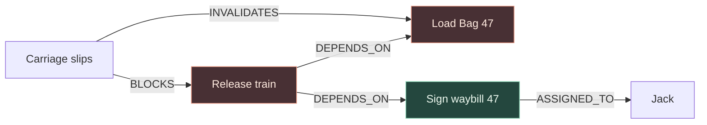

# Moonmail

**Moonmail is a proof of concept for assigning work to robots with different bodies and revising their plan when equipment fails.** In its simulated railway depot, pickers, couriers, forklifts and mechanics move on a grid and handle parcels through symbolic actions. If a forklift breaks, can it still sign for a delivery?

One embedded **Relate knowledge graph** holds the fleet’s capabilities, parcel custody, departure conditions and plan history. A single LLM orchestrator reads that state and proposes jobs, robots and dependencies. A validator checks the proposal with Z3. The executor queries ready jobs from Relate and writes back their effects. After a fault, the next graph read tells the orchestrator which assignments still hold.

## Find your way

| To explore | Open |
| --- | --- |
| See the entry and watch a dispatch recover from a fault | [Film · 1 min 59 s](moonmail-demo.mp4) · [Captions](docs/moonmail.en.srt) · [Submission brief](docs/submission.md) |
| Understand the architecture and trace a decision | [Architecture slides (PDF)](docs/presentation.pdf) · [Worked example, schema and Cypher](docs/architecture.md) |
| Replay the three recorded LLM runs or try a different fleet | [Launch the station](#run-it) · [Experiments and LLM setup](docs/running.md) |
| Inspect the implementation or the original evidence | [Python dispatcher](moonmail/) · [Browser viewer](viewer/src/) · [Recorded Relate files](viewer/public/episodes/) |

## Run it

Clone the repository or extract the ZIP, then run either command from the project directory. [Download ZIP](https://github.com/ValerioBelcamino/Moonmail/archive/refs/heads/main.zip)

| Docker Compose | Python via uv |
| --- | --- |
| `docker compose up --build` | `uv run --locked -m moonmail` |

**[Open the guided station](http://127.0.0.1:8041/?guide=1).** Click the highlighted controls to inspect robot abilities, pause on a decision and query the graph. Recorded LLM runs and fresh runs with the local planner work without credentials. For fresh LLM decisions, connect your own deployment. [Setup guide](docs/running.md#connect-your-own-llm)

## One fault in the graph

At step 26 in the filmed run, Jack’s fork carriage slips. These are relationships you can query in the recorded file.

Jack’s scanner still works. The revised plan keeps the same signing action and adds a repair before loading. Change the mechanic’s hex driver to an inspection probe and the orchestrator sends the bag via the station lift instead. [Inspect the fault in the station](http://127.0.0.1:8041/?reel=post&at=fault) · [Inspect the probe run](http://127.0.0.1:8041/?reel=post-probe&at=rejected)
