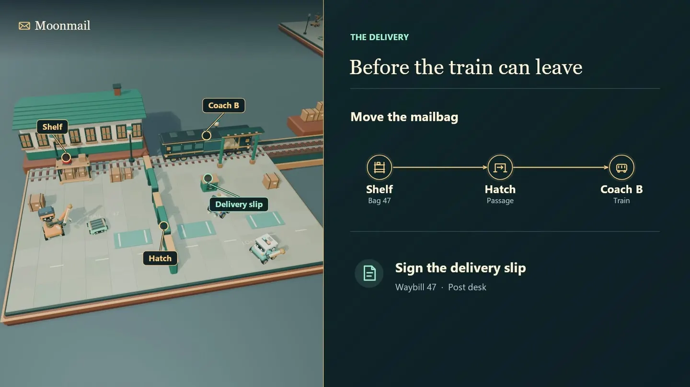

# Moonmail

When a forklift breaks, which jobs can the fleet still finish? Moonmail is a railway dispatch simulator. An LLM proposes jobs for robots with different bodies. **Relate connects each robot’s skills and mounted tools to the work that depends on them.**

Change just the mechanic’s tool. With a hex driver, Patch repairs Jack’s carriage. With an inspection probe, the validator rejects the proposed repair and the LLM sends Skim to the station lift. Open either run and follow the decision back to the graph.

[Watch the film · 1 min 59 s](moonmail-demo.mp4) · [Architecture slides (PDF)](docs/presentation.pdf) · [Worked example and Cypher](docs/architecture.md)

## Run it

From the repository directory, choose either launcher.

| With Docker Compose | With Python via uv |
| --- | --- |
| `docker compose up --build` | `uv run --locked -m moonmail` |

**[Open the station](http://127.0.0.1:8041/)** and select **Quick guide**. Three recorded LLM runs and fresh local experiments work without credentials.

- **Robot bodies** shows the chassis, skills and mounted equipment of each robot.
- **Query graph** pauses playback. Inspect world facts, assignments and fault impact at that step. Completed runs also accept your own Cypher queries.
- **Run options → Custom fleet** lets you choose the orders, robot counts, tool and fault. **Local planner** works without a key. **LLM orchestrator** uses your deployment. [Setup and experiments](docs/running.md)

## Why one Relate file per run?

The executor queries ready actions and writes their effects into the same graph that the orchestrator reads. Both plan revisions can link to the same surviving action. One portable file preserves those identities, the proposals and the evidence for each decision. [Three bundled stores](viewer/public/episodes) · [Tools and AI credits](docs/submission.md#what-we-built-with)
