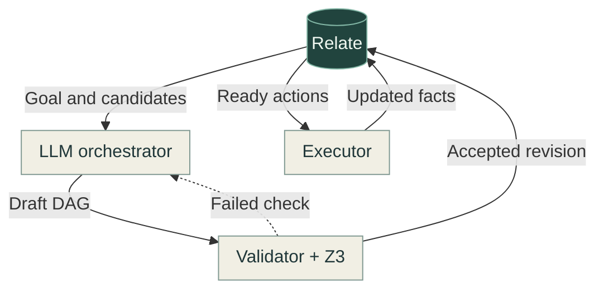
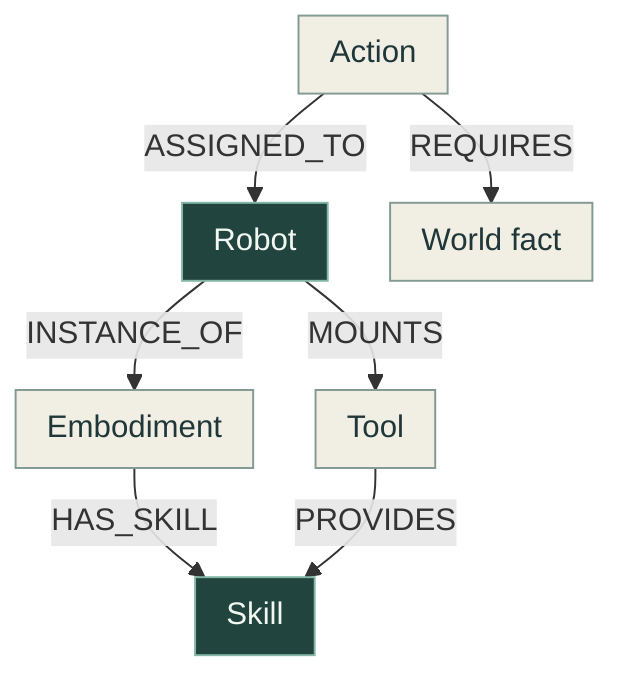

# Moonmail

**Moonmail is a multi-robot dispatch simulator built on Relate, Neo4j’s embedded graph database.** Given a delivery goal, a single LLM reads the fleet’s capabilities and proposes the remaining jobs and their dependencies in one plan. Robots in the yard can start independent jobs together. When a breakdown derails the plan, Relate shows which assignments still hold, and the LLM uses those facts to revise the affected work.

The setting is a railway mail depot. Each bag must reach the coach serving its destination, and its delivery slip must be signed before the train leaves. A picker can reach a high shelf, a low courier fits through the service hatch, and a forklift can lift the tray into the coach. A robot with a scanner can sign independently of loading. The 3D depot animates grid moves and symbolic handoffs beside the graph, so you can pause at a decision and inspect the facts behind it.

[Watch the film · 1 min 59 s](moonmail-demo.mp4) · [Run the station](#run-it) · [Architecture slides (PDF)](docs/presentation.pdf) · [Repository guide](#repository-guide)

Across 68 paired trials, **median time spent in model calls fell from 10.09 to 7.91 seconds per trial (21.6%)**, and Moonmail used **55.3% fewer tokens**. The same model produced 52 correct first drafts with the Relate read versus 33 with the full-state prompt. With validator feedback, the final scores were 68/68 and 65/68. [Planning benchmark and recorded decisions](benchmarks/results/README.md)

## From a goal to an executable plan

Moonmail’s local symbolic planner works backward from the goal through the actions that can satisfy it. The LLM reads the same action contracts and proposes its own directed acyclic graph (DAG), choosing which actions to combine and which must finish first. Both planners can replan after a fault. The LLM can also revise a rejected draft using the validator’s explanation. Z3 checks robot assignments in either mode. [How the planners use the graph](docs/architecture.md#how-the-two-planners-use-the-graph)

In one recorded run, the validator rejects a repair because the mechanic’s probe does not fit the broken carriage. The LLM switches the load to the station hoist and keeps the existing signing assignment. Both plan revisions point to the same signing action in Relate. [Compare two recoveries from the same fault](docs/architecture.md#a-decision-you-can-reproduce)

See one recorded dispatch move through the loop

## What makes a robot eligible?

The fleet graph exists before the first plan. An **embodiment** records a robot body’s height, reach and supported skills. For a lift, the query matches the chassis and a mounted carriage to the same skill on the same robot. The accepted load action links to that robot and requires the carriage to be online when it runs. [Embodiment queries](docs/architecture.md#how-a-body-becomes-a-planning-choice) · [Full graph schema](docs/graph-schema.md)

## Run it

From a clone or the extracted project ZIP, run either command. [Download ZIP](https://github.com/ValerioBelcamino/Moonmail/archive/refs/heads/main.zip)

| Docker Compose | Python via uv |
| --- | --- |
| `docker compose up --build` | `uv run --locked -m moonmail` |

**[Open the guided station](http://127.0.0.1:8041/?guide=1).** Replay three recorded LLM dispatches or run a different fleet with the keyless local planner. For fresh LLM decisions, connect your own deployment. [Experiments and LLM setup](docs/running.md)

## Repository guide

| To explore | Open |
| --- | --- |
| Inspect a decision in the database | [Worked example and Cypher](docs/architecture.md) · [Three recorded Relate files](viewer/public/episodes/) |
| Compare the same LLM with two ways of reading the world | [Paired decisions and scores](benchmarks/results/README.md) · [Benchmark design and reproduction](benchmarks/README.md) |
| Follow the implementation | [LLM tools](moonmail/mail_agent.py) · [Plan validation](moonmail/mail_planning.py) · [Relate queries](moonmail/mail_store.py) · [3D viewer](viewer/src/) |
| Review the competition materials | [Submission brief](docs/submission.md) · [English captions](docs/moonmail.en.srt) · [How the film was made](tools/film_review/README.md) |
