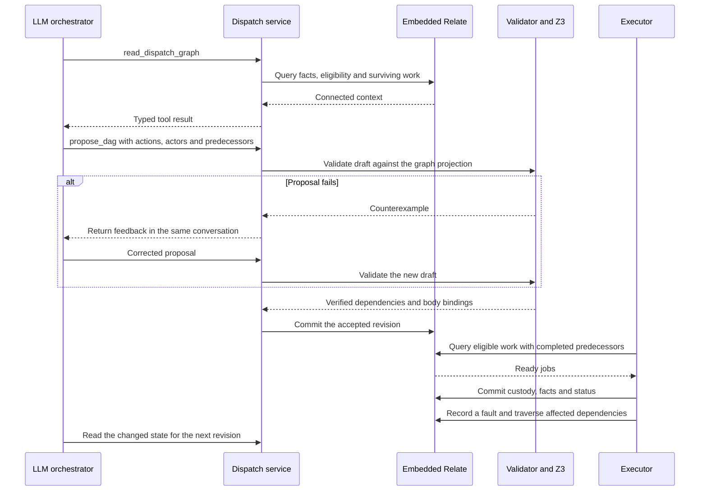
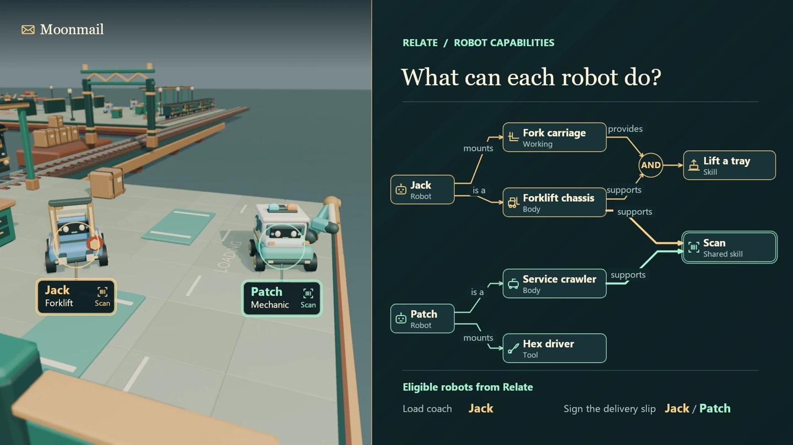
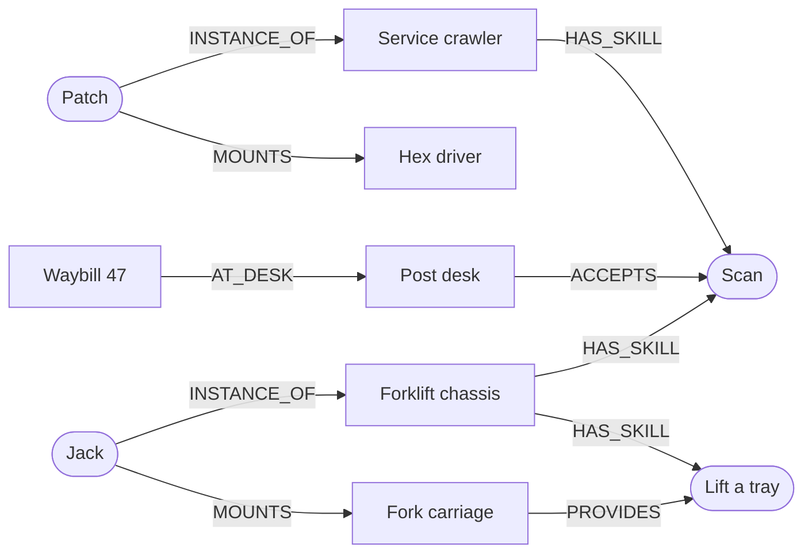
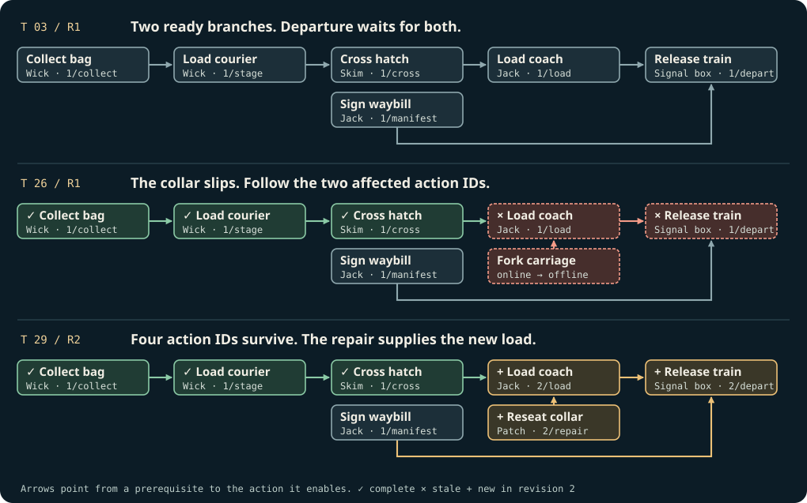
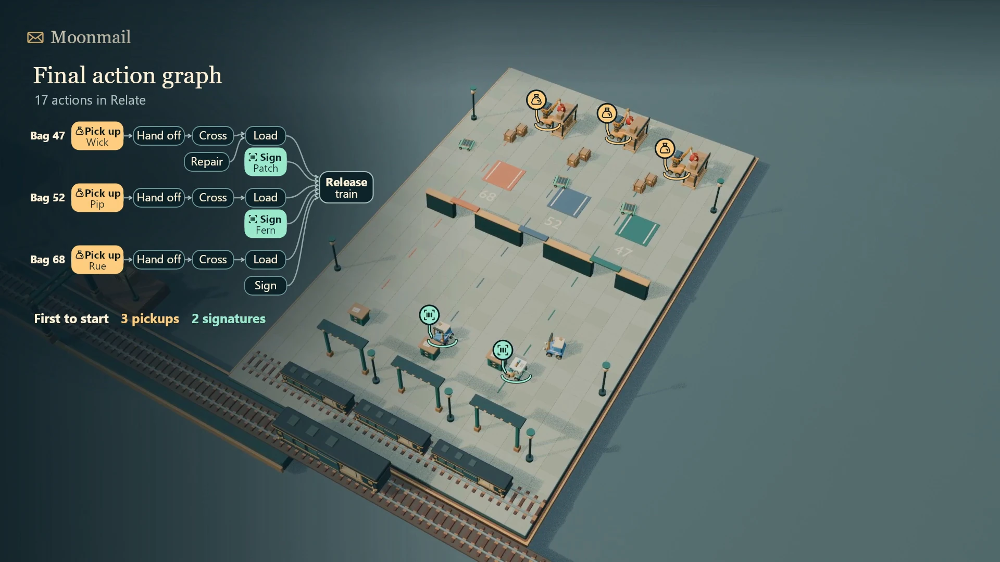
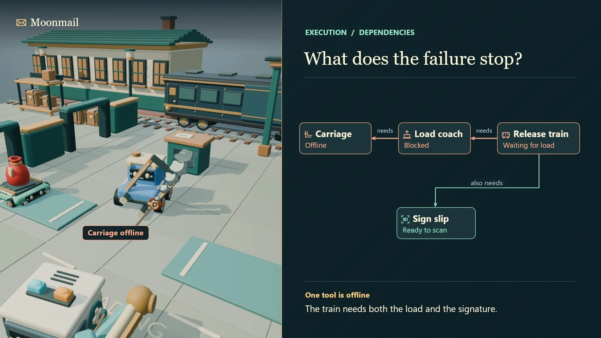

# How one graph coordinates a fleet

Before the train can leave, Bag 47 must reach Coach B and a robot must sign the delivery slip. The orchestrator needs to find a robot for each job. If the fork carriage breaks, it also needs to know which jobs can still run. Moonmail keeps robot capabilities, live facts and action dependencies in one embedded Relate file per execution. Each accepted plan revision links to the actions it uses, so a later revision can reuse the surviving work. [Film](../moonmail-demo.mp4) · [Run the station](../README.md#run-it)

The picker’s arm reaches 125 cm. The shelf is 110 cm high. The courier can fit through the hatch while carrying the bag. These capabilities exist before any plan does. Compare them with a fact that changes during execution: at step 22, the bag’s holder becomes the courier. Those two kinds of information let the orchestrator answer both “who could do this?” and “who can do it now?” [Picker assignment](http://127.0.0.1:8041/?reel=post&at=4) · [Recorded handoff](http://127.0.0.1:8041/?reel=post&at=22)

## How the two planners use the graph

The planning horizon is the current delivery goal. In the three-order recording, one proposal covers 16 actions through train departure. The yard executor starts five of them together, after checking their prerequisites and reserving the robots and routes. A fault can trigger a new planning decision before the train reaches that goal. [The recorded three-order plan](#the-larger-run) · [Yard execution](../moonmail/yard.py)

The local symbolic planner searches backward through action effects and compares feasible forklift and hoist combinations. The LLM reads the goal and the same action contracts, then proposes actions, robot assignments and causal dependencies. It can try a different combination when the validator explains why a draft failed. Both planners can recover from a fault. Relate tells each which pending assignments must survive, and the validator enforces those commitments in the next revision. [Symbolic planner](../moonmail/mail_planning.py) · [LLM proposal and correction loop](../moonmail/mail_agent.py)

## One dispatch cycle



The viewer follows the same sequence. **Facts available to the orchestrator** shows its input. **Proposed action plan** shows the submitted draft. **Approved action plan** shows the revision the executor can run. **Query graph** pauses playback and runs a selected Cypher query as of the playhead. Facts and action statuses decode the latest committed event snapshot at that step. Eligibility comes from the last planning read. The event evidence underneath records the query, returned rows and model payload at the selected simulation step.

**Robot bodies** traverses the actual robot, chassis, skill and mount relationships from the run’s Relate file. The selected step supplies the online state of Jack’s carriage. During live execution the inspector reads an atomically published checkpoint. Fault and revision queries apply the playhead tick before returning rows. The optional Cypher editor opens a read-only connection to a completed store. Its example uses the bound `$tick` to select historical events.

The tool adapter assembles the model input with Cypher and passes a typed projection to the orchestrator. Its proposed DAG is an explicit list of operations with an `after` list and a nominated actor or `auto`. The validator checks the allowed operations, graph structure, body bindings, custody and the effects that support each precondition. Failed submissions remain visible as attempts. Only a successful plan is eligible for execution. [Model tool definitions and retry loop](../moonmail/mail_agent.py) · [Causal validation](../moonmail/mail_planning.py) · [Orchestration](../moonmail/mail_episode.py)

## How a body becomes a planning choice

Jack has a forklift chassis. Patch has a service crawler chassis and is the fleet’s mechanic. Both bodies support **Scan**. Jack’s chassis also supports **Lift a tray**. The carriage mounted on Jack supplies the physical capability. The loading query matches both paths to the **same robot and skill**. The **AND** in the opening illustrates this join. Relate stores the relationships shown below. [Watch the opening locally](http://127.0.0.1:8041/review/film.html#t=0)





**Lift a tray** names the skill. **Load coach** names the action that uses it. The stored identifiers are `Fork` for the skill and `Lift` for the chassis. This query works on the bundled recording and on new runs. It returns one row, `Jack · Lift · Fork carriage · Lift a tray`. [Recorded graph](../viewer/public/episodes/post.rl)

```cypher
MATCH (r:Robot {id:'Jack'})-[:INSTANCE_OF]->(b)-[:HAS_SKILL]->(s:Skill {id:'Fork'})
MATCH (r)-[:MOUNTS]->(t:Tool)-[:PROVIDES]->(s)
RETURN r.id AS robot, b.id AS body, t.id AS tool, coalesce(s.label,'Lift a tray') AS skill
```

Signing the delivery slip is the job. Scanning is the skill the desk accepts as a signature. This query returns `Jack · Lift · Scan` and `Patch · Service crawler · Scan`. Each body reaches the same node. The planner also checks the robot’s zone when computing the actual candidate list. [Recorded graph](../viewer/public/episodes/post.rl) · [Opening evidence queries](../tools/film_review/evidence.py)

```cypher
MATCH (r:Robot)-[:INSTANCE_OF]->(b)-[:HAS_SKILL]->(s:Skill)
      <-[:ACCEPTS]-(d:Desk)<-[:AT_DESK]-(:Waybill {id:'Waybill 47'})
WHERE r.id IN ['Jack','Patch']
RETURN r.id AS robot, b.id AS body, s.id AS skill ORDER BY robot
```

The loading query checks Jack’s location, the skill accepted by the tray and the height of the destination. Jack reaches 85 cm and the coach sill is 75 cm. For signing, a separate query follows the skill accepted by the desk. That distinction matters when the orchestrator proposes its six actions. Its loading assignment is forced. Its signing assignment can go to either scanner. Jack happens to be the signer in this recording. [Eligibility queries](../moonmail/mail_store.py) · [Read at tick 1](http://127.0.0.1:8041/?reel=post&at=read)

| Job | Eligible in the first graph read | Actor in the model’s proposal |
| --- | --- | --- |
| Load Coach B | Jack | Jack |
| Sign Waybill 47 | Jack, Patch | Jack |

The model returns six actions and their predecessor lists. Its proposed release depends on **both** loading and signing. The validator checks the proposal before the service stores revision 1. To start loading, the executor needs the addressed cargo on the platform and the carriage online. [Recorded proposal](http://127.0.0.1:8041/?reel=post&at=proposal) · [Action preconditions](../moonmail/mail_planning.py)

With Patch’s hex driver installed, changing the carriage in the graph gives three different validated plans in the local planner. [Capability and planning tests](../tests/test_mail.py)

| Jack’s fork carriage | Can Jack lift now? | How does the plan get the tray aboard? |
| --- | --- | --- |
| Mounted and working | Yes | Jack loads the coach. |
| Mounted and offline | No | Patch reseats the collar, then Jack loads the coach. |
| Detached | No | Jack drops out of the loading candidates. Skim brings the tray to the station lift. |

Jack keeps his chassis type and scanning skill in all three cases. At tick 26 the executor records a carriage fault, invalidates the load and follows its dependency to the departure. Jack’s pending signature survives. At tick 27 the orchestrator can still see which robot could load **after repair**, along with the failed condition that its next proposal must resolve. Detachment is a separate case covered by the capability tests. [Fault impact](http://127.0.0.1:8041/?reel=post&at=fault) · [Next model input](http://127.0.0.1:8041/?reel=post&at=reread) · [Capability tests](../tests/test_mail.py)

## What persists

The table summarizes the data used in one dispatch. The schema reference lists every node label and directed relationship across both layouts, including those created only during execution. [Full graph schema](graph-schema.md)

| Information | Example relationships or records | When it changes |
| --- | --- | --- |
| Station and fleet | A robot `INSTANCE_OF` an embodiment with a `HAS_SKILL` edge. A robot `MOUNTS` an instrument that `FITS` an interface. A parcel is `ADDRESSED_TO` a route, and a coach `SERVES` that route. | Seeded per run. A failed tool changes availability and therefore eligibility. |
| Current state | The parcel’s `HELD_BY` edge, robot positions, gate and tool availability, the waybill and train signal. `WorldFact` nodes expose current values to action guards. | The executor records transfers and changes at action or observation boundaries. |
| Proposed and admitted work | `ProposalAttempt` stores the submitted JSON, author, intended revision, verdict and feedback. A `PlanRevision` `INCLUDES` actions with `ASSIGNED_TO`, `DEPENDS_ON`, `REQUIRES` and `ESTABLISHES` edges. | Every attempt is recorded. An accepted revision links to its predecessor and can include existing action nodes. |
| History | An observation `VIOLATES` a fact, `INVALIDATES` a directly affected action and `BLOCKS` a downstream action. Stored events carry the point-in-time plan and tool evidence. | Appended as observations, attempts and completions occur. The final database can still answer what changed and why. |

The application finds grid paths and reserves bodies and cells for concurrent jobs. The database holds the durable operational state and task dependencies. The renderer interpolates between recorded positions and animates handling. Scrubbing the viewer reads the event snapshot for that tick. Running a new episode executes the graph queries again. [Storage and readiness](../moonmail/mail_store.py) · [Station execution](../moonmail/mail_episode.py) · [Concurrent execution](../moonmail/yard.py)

## How a dispatch recovers

The executor records the observation and updates the current facts. The dispatcher checks the pending actions in the accepted revision. If a required value no longer holds and no pending predecessor will establish it, the observation invalidates that action. Following `DEPENDS_ON` finds downstream jobs that must also be reconsidered. Completed actions and unaffected pending assignments keep their identities. [Precondition checks and dependency traversal](../moonmail/mail_store.py)

The LLM receives the new facts, eligible actors and surviving assignments. It proposes a continuation and the validator checks it against that state. A rejected proposal returns a reason the LLM can use for a retry. Execution resumes from an accepted revision. If the dispatcher cannot find a verified path to the goal, it records a hold. [Revision and hold logic](../moonmail/mail_episode.py)

## A decision you can reproduce

**Change only the mechanic’s tool. Does the recovery change, and does independent work keep its assignment?** The two one-order recordings use the same four robots, layout seed, delivery goal and fork failure. In both, Bag 47 needs to reach Coach B and its waybill needs a signature. Wick can reach the shelf, Skim fits the hatch and the orchestrator nominates Jack to load and sign. [Initial facts](http://127.0.0.1:8041/?reel=post) · [Model input](http://127.0.0.1:8041/?reel=post&at=read)

| Simulation tick | Graph or tool event |
| --- | --- |
| 1–3 | The agent reads the projected context, submits six actions, and receives an accepted verdict. The cargo and signature branches meet at departure. |
| 10, 22, 25 | Custody moves from the shelf to Wick and then to Skim. Skim completes the crossing. These three actions now have durable identities and completed status. |
| 26 | The fork observation invalidates `1/load`. Following dependencies reaches `1/depart`. The waybill assignment survives because it uses Jack’s independent scanning skill. |
| 27–29, driver | The new input includes Patch’s hex driver and matching collar. The orchestrator proposes a repair. Revision 2 adds three action nodes and includes four originals, including the pending signature. |
| 28–31, probe | The orchestrator first proposes a repair with an open actor binding. The validator returns `repair has no eligible body in the graph` at tick 29. The orchestrator submits `hoist` at tick 30. Revision 2 is admitted at tick 31. |
| 60, driver / 59, probe | The train signal turns green once the stored load and signature conditions hold. |



With the hex driver, the revised plan repairs the carriage and then loads Coach B. The probe fits a test socket, so the validator rejects the proposed repair and the LLM routes Skim’s tray through the station lift. Open **Query graph** on the rejected draft to see the tool context, the proposal and the failed check. [Rejected draft](http://127.0.0.1:8041/?reel=post-probe&at=rejected) · [Corrected proposal](http://127.0.0.1:8041/?reel=post-probe&at=retry)

To check what survives, open either recording and select **Query graph → Write Cypher on the completed run**. The query returns four original actions and their assigned robots. The pickup, handoff and crossing were already complete when the fork failed. The row `1/manifest → Jack` identifies the signing action that was still pending. Both revisions in that file point to the same node. [Driver database](../viewer/public/episodes/post.rl) · [Probe database](../viewer/public/episodes/post-probe.rl)

```cypher
MATCH (:PlanRevision {rev:1})-[:INCLUDES]->(a:Action)<-[:INCLUDES]-(:PlanRevision {rev:2})
MATCH (a)-[:ASSIGNED_TO]->(r:Robot)
RETURN a.uid AS original_action, r.id AS assigned_to
ORDER BY original_action
```

## Read the evidence in Cypher

Run `uv run --locked python tools/inspect_dispatch.py` from the repository root. It queries the three bundled databases directly. To inspect the retry, open `viewer/public/episodes/post-probe.rl` read-only and use this query. It returns a rejected repair draft with its reason and an accepted draft containing the hoist. [Runnable inspection](../tools/inspect_dispatch.py)

```cypher
MATCH (p:ProposalAttempt {revision:2})
RETURN p.outcome AS verdict, p.feedback AS feedback, p.proposal AS draft
ORDER BY verdict DESC
```

At dispatch time, the executor uses the following readiness query. The diagram draws an arrow from the prerequisite to the action it enables. In the database, the action points back to its prerequisite. The executor checks the current guard values before applying effects. [Readiness query](../moonmail/mail_store.py)

```cypher
MATCH (:PlanRevision {rev:$rev})-[:INCLUDES]->(a:Action {status:'pending'})
WHERE NOT EXISTS {
  MATCH (a)-[:DEPENDS_ON]->(p:Action) WHERE p.status <> 'done'
}
RETURN a.uid AS uid, a.op AS op
```

## Extending the scenario

### What changes when you add a second bag?

Configure two bags for the same train. The yard writes a second order, Bag 52, its waybill, and links to its own shelf, hatch and destination coach in Relate. Each order has its own facts. Loading Bag 47 sets `47/cargo` to `aboard`. Bag 52 still has to reach its own coach.

The orchestrator reads both orders and their eligible robots in one call. In a direct-loading plan it proposes a pickup, handoff, hatch crossing and coach load **for each bag**, plus an independent waybill signature. There is still **one train release**. The validator checks its prerequisites across all orders and Relate stores the accepted dependencies. [Order-specific actions and departure conditions](../moonmail/yard.py) · [Validator](../moonmail/mail_planning.py)

| Bags on the same train | First plan | Jobs the release waits for |
| --- | --- | --- |
| 1 | 5 bag jobs + 1 release = **6 actions** | 1 load and 1 signature |
| 2 | 10 bag jobs + 1 release = **11 actions** | 2 loads and 2 signatures |
| 3 | 15 bag jobs + 1 release = **16 actions** | 3 loads and 3 signatures |

To reproduce all three rows, use **Run options → New run → Custom fleet**. Select the **Local planner**, seed **7**, **Hex driver** and **Clear run**. Set orders, pickers and couriers to the number in the first column. Keep one forklift and one mechanic. All three configurations deliver. A repair introduces extra work, so these counts describe the initial direct-loading plans. [Experiment controls](running.md#run-a-different-fleet)

The headless benchmark extends this pattern to six orders, fourteen robots and a 31-action plan. Judges can read three paired trials of the same model against the same six-bay graph, including each first draft and its validator feedback. [Six-order benchmark traces](../benchmarks/results/six-orders/README.md)

Once the two-order run finishes, open **Query graph → Write Cypher on the completed run**. The four rows are `47/load`, `47/manifest`, `52/load` and `52/manifest`. Here `manifest` means signing that bag’s waybill.

```cypher
MATCH (:PlanRevision {rev:1})-[:INCLUDES]->(:Action {op:'depart'})-[:DEPENDS_ON]->(p:Action)
RETURN p.op AS must_finish ORDER BY must_finish
```

### Which courier serves the new bay?

Both two-order experiments use the same 26 × 14 grid. On that grid, activating Bay 52 adds a shelf, a passage and a coach for Eastbank. The planner can find the route by following the order’s links in Relate. The executor uses the layout’s coordinates to move through it. [Route query and grid layout](../moonmail/yard.py)

Keep the two-order settings above and change only the courier count.

| Couriers | What the planner reads | Outcome |
| --- | --- | --- |
| 1 | Skim serves Bag 47. The list of eligible robots for `52/cross` is empty. | Train held at red |
| 2 | Dash serves Bag 52 and has the same low courier chassis as Skim. Each order now has a robot that can carry its bag under its hatch. | Both bags aboard, train released |

The yard’s eligibility query follows `(robot)-[:SERVICES]->(order)` and reads the chassis skills and dimensions. A crossing needs a carrying deck and enough clearance with the bag aboard. Adding Dash changes the set of candidates the planner sees. The same validation rules apply to both fleets.

### A fifth chassis in the planner

Dash adds another instance of a familiar body. To introduce a **new body type**, this separate symbolic test adds a robot named Ink at the platform desk, a new Scanner cart chassis and a link from that chassis to the existing Scan skill. The signing query now returns Jack, Patch **and Ink**. The local planner leaves the actor open and Z3 assigns Ink, which is already at the desk. Jack is still the only eligible loader.

From the repository root, run this command.

```bash
uv run --locked python - <<'PY'
import relate
from moonmail.depot import layout
from moonmail.mail_planning import local_plan, verify
from moonmail.mail_store import seed_mail, world_state

scene = layout(7, "driver")
with relate.connect(":memory:") as db:
    seed_mail(db, scene, 18, True)
    db.execute("""
        MATCH (zone:Zone {id:'Platform'}), (scan:Skill {id:'Scan'})
        CREATE (r:Robot {id:'Ink', x:9, z:3})-[:IN_ZONE]->(zone),
               (r)-[:INSTANCE_OF]->(b:Embodiment {id:'Scanner cart', cm:28, deck:0, reach:35}),
               (b)-[:HAS_SKILL]->(scan)
    """)
    world = world_state(db, scene)
    plan = verify(local_plan(world, {}), world)
    print("Eligible to sign", sorted(world.options["manifest"]))
    print("Assigned to sign", plan.actors["manifest"])
    print("Eligible to load", sorted(world.options["load"]))
PY
```

The interactive station renders four body types. Giving Ink a place in that interface would also require a roster entry and a visual model. A new kind of action, such as one with a different physical effect, needs an operator with preconditions and effects plus executor support. [Built-in action definitions](../moonmail/mail_planning.py)

## The larger run

The one-order recording uses four robots on a 14 × 8 grid. The three-order recording uses a 26 × 14 yard with three pickers, three couriers, two forklifts and one mechanic. That gives nine robots across the same four chassis types. The LLM reads the larger graph through the same tool and proposes one plan for the train. Independent jobs can run together when their robots and paths are free. [Recorded yard](../viewer/public/episodes/yard.rl) · [Fleet settings](running.md#run-a-different-fleet)

- **Tick 4.** Three pickups and two scans start together. The orchestrator left all sixteen actor choices to the validator. The plan contains five parcel actions per order and one shared signal-box release.
- **Tick 30.** The fork observation directly invalidates Bag 47’s load and transitively blocks the common departure. The other two loading branches survive.
- **Ticks 33–34.** The 17-action revision keeps fourteen of the original sixteen action nodes. Fern starts loading Bag 52 at the same step that Patch starts repairing Jack for Bag 47. Their jobs use different robots and neither depends on the other.
- **Tick 78.** All three loads and all three waybills satisfy the shared departure. The train clears the signal.

The film places the final 17-action plan beside the fleet as its first five jobs start. Gold marks the three pickups and green marks the two signatures. The robot names in those nodes come from the same assignments as the markers on the depot floor. Follow each bag’s load and signature to see why the train has six prerequisites. [Watch the fleet arrive](http://127.0.0.1:8041/review/film.html#t=102.8)



The following Cypher counts shared node identities in the actual database. It returns **14** for the three-order setup and **4** for each one-order recording. These figures describe the bundled runs. [Three-order database](../viewer/public/episodes/yard.rl) · [Three-order layout and motion frames](../viewer/public/episodes/yard.json)

```cypher
MATCH (v:PlanRevision {rev:2})-[:REVISES]->(old)
MATCH (old)-[:INCLUDES]->(a:Action)<-[:INCLUDES]-(v)
RETURN count(a) AS original_actions_kept
```

## Rendering the evidence

The opening follows the shelf, hatch, coach and signing desk with markers projected through the Blender camera. Its two robot branches join at the Scan node read from the recorded database. The middle follows one execution through a slipped collar, a surviving signature, a compatible repair and the approved departure. The camera rides with that train into the larger depot and holds on the five robots working in parallel before a one-second silent end card. [Film scene and edit](../tools/film_review/README.md)

The film samples the viewer’s robot trajectories, arm joints, mast and bag position against the recorded ticks. Blender evaluates a continuous camera path at 60 frames per second. When the mast tips, a short burst of sparks and drawn smoke follows the actual 3D collar. The graph reads the same fault tick to mark the load and departure. The revision brings the existing signature node forward and adds Patch’s repair as a prerequisite of the load. [Recorded graph queries](../tools/film_review/evidence.py) · [Robot poses](../tools/film_review/export_scene.py) · [Camera and scene](../tools/film_review/studio.py)



In the interactive viewer, the mast tips and its collar changes colour when the fork fails. If moving frames repeatedly miss their time budget, the 3D buffer temporarily sheds supersampling. Pausing restores full detail. Once the fork settles, the viewer holds the 3D view while its labels follow the load, departure and surviving signature. Switching layouts plays a pullback and dissolve. Reduced-motion playback switches directly. [Playback and transitions](../viewer/src/story.ts)
